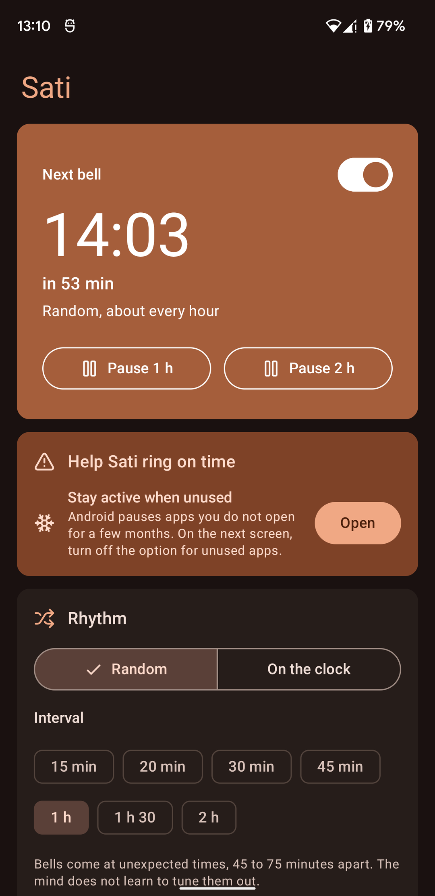
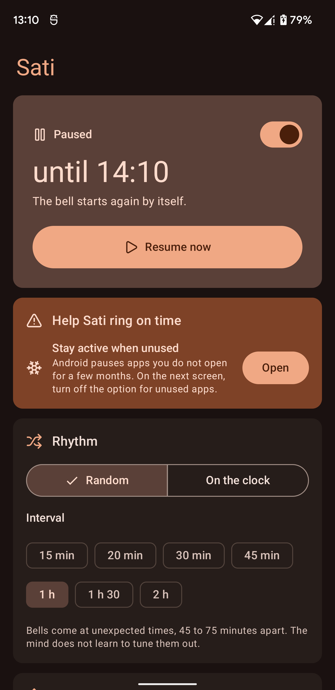
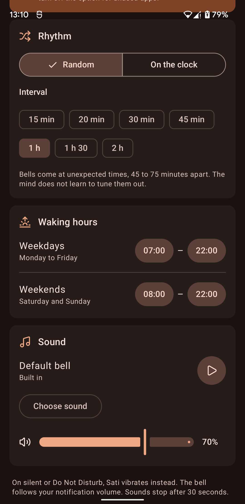
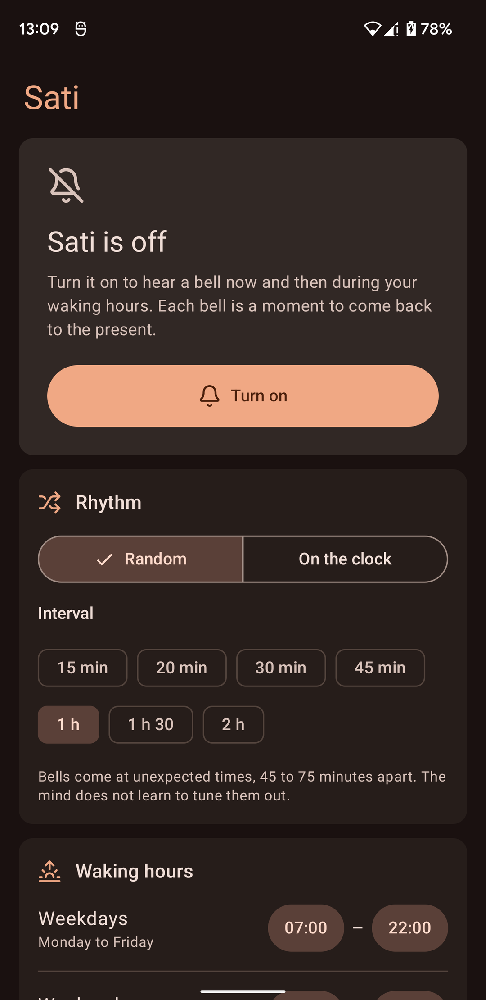

# Sati

Sati is an Android app that rings a bell now and then during your waking hours. Each bell is a moment to come back to the present. The name is the Pali word for mindfulness.

<p>
  
  
  
  
</p>

## Features

- Random rhythm, so the mind does not learn to ignore the bell, or a fixed rhythm on the clock.
- An interval from 15 minutes to 2 hours.
- Separate waking hours for weekdays and weekends.
- Pause for one or two hours. The bell starts again by itself.
- On silent, the phone vibrates instead. During Do Not Disturb, Sati stays quiet.
- The built-in bell or your own sound, with its own volume.
- A Quick Settings tile to turn the bell on or off.
- It keeps ringing after a restart, even before the first unlock.

Sati has no internet permission. It collects nothing.

## Install

Sati needs Android 12 (API 31) or later.

Download the APK from the [latest release](https://github.com/5h1vmani/sati/releases/latest).

To get updates automatically, use [Obtainium](https://github.com/ImranR98/Obtainium):

1. Install Obtainium.
2. In Obtainium, tap Add App and enter `https://github.com/5h1vmani/sati`.
3. Obtainium installs Sati and tells you when a new version is out.

Android asks once whether Obtainium may install apps. Allow it.

Every release is signed with the same key. Its SHA-256 certificate fingerprint is:

```
6C:F8:5B:0E:54:C9:1A:E1:84:64:E9:B3:C9:EB:15:C6:9B:CB:0C:5D:4D:85:CF:F8:2F:AF:CC:E6:68:DC:9D:3C
```

## Build

The build needs JDK 17 or later and the Android SDK.

```bash
./gradlew testDebugUnitTest assembleRelease
```

This builds an unsigned release APK, which is how F-Droid builds it. The maintainer signs official releases with `tools/release.sh`. That script reads the key from outside the repo and its password from the macOS Keychain.

## Project layout

- `app/src/main/java/com/padakanti/sati/Scheduler.kt` picks the next bell time. It has no Android code and is unit-tested.
- `Alarms.kt` keeps exactly one exact alarm set for the next bell.
- `BellAction.kt` decides whether a bell plays, vibrates or stays quiet. It has no Android code and is unit-tested.
- `Ringer.kt` reads the phone's state, then plays the bell or vibrates.
- `ui/` holds the Compose screen and the theme.
- `tools/lucide_to_vector.py` converts Lucide icons into Android vector drawables.
- `tools/contrast.py` checks that every colour pair in the theme meets WCAG AA contrast.
- `tools/release.sh` builds and signs a release APK.
- `docs/ROADMAP.md` holds the plan for the next versions.

## How it is made

Sati's code is written with Claude, an AI coding tool made by Anthropic. Every commit says so in a `Co-Authored-By` line. Each release is tested on a real phone before it is published.

## Credits

- Icons: [Lucide](https://lucide.dev), ISC license; a few icons derive from Feather, MIT license. Full texts are in [NOTICE](NOTICE).
- Bell sound: a ghanta (Tibetan hand bell) recorded by [the_very_Real_Horst](https://freesound.org/people/the_very_Real_Horst/sounds/274316/), CC0, via [Wikimedia Commons](https://commons.wikimedia.org/wiki/File:274316_the-very-real-horst_ghanta-leather-mallet-2015-05-16.wav). Trimmed to one strike and faded out.

## License

Sati is free software under the GNU General Public License, version 3 or any later version. See [LICENSE](LICENSE).
