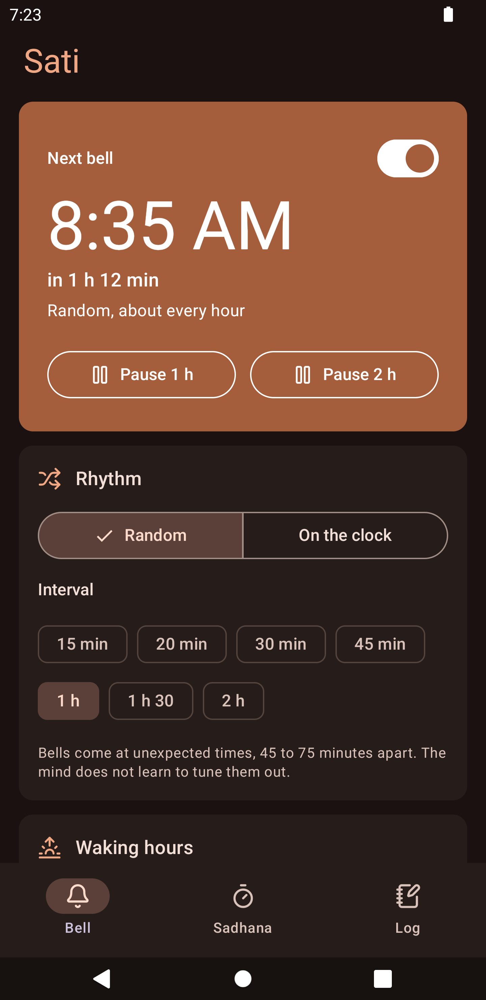
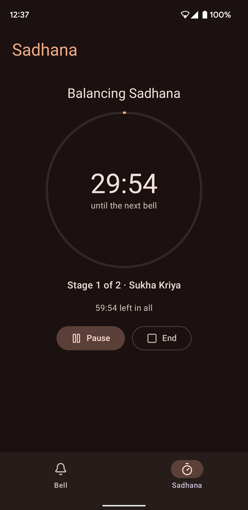
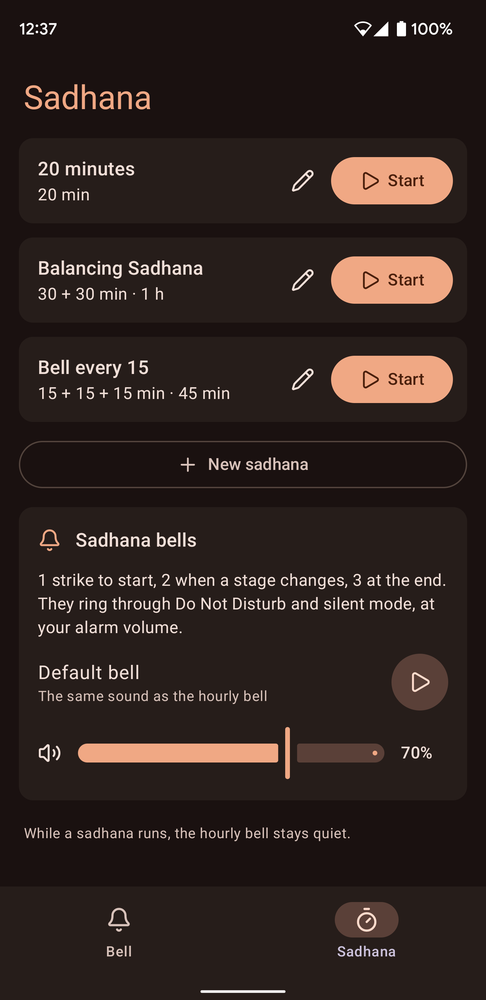
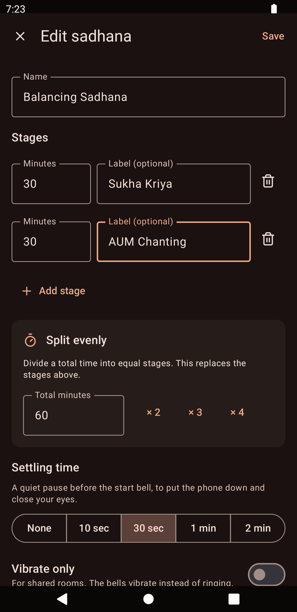

# Sati

Sati is an Android app that rings a bell now and then during your waking hours. Each bell is a moment to come back to the present. The name is the Pali word for mindfulness.

<p>
  
  
  
  
</p>

## Features

- Random rhythm, so the mind does not learn to ignore the bell, or a fixed rhythm on the clock.
- An interval from 15 minutes to 2 hours.
- Separate waking hours for weekdays and weekends.
- Pause for one or two hours. The bell starts again by itself.
- On silent, the phone vibrates instead. During Do Not Disturb or a phone call, Sati stays quiet.
- The built-in bell or your own sound, with its own volume.
- A Quick Settings tile to turn the bell on or off.
- It keeps ringing after a restart, even before the first unlock.

Sadhana is a timer for a timed practice, such as breathing exercises, chanting or yoga.

- Split a practice into up to 10 stages, each with an optional label.
- The bell rings once at the start, twice when a stage changes and three times at the end, so you can tell them apart with your eyes closed.
- Sadhana bells ring through Do Not Disturb and silent mode, at your alarm volume, with their own volume slider. If Do Not Disturb blocks alarms, they play at your media volume instead.
- An optional settling time before the start bell, and a vibrate-only mode for shared rooms.
- A lock-screen countdown to the next bell, with a Pause button.
- The hourly bell stays quiet while a sadhana runs.

The practice log records every practice, not only the timed ones.

- Keep a list of practices, each counted as a duration (minutes and seconds), cycles, done, percent or a scale of 1 to 10. Durations and cycles can have a daily target. Move practices up and down, or let one repeat every 2 to 7 days.
- Today shows each practice and its progress. A done practice takes one tap, and a cross button marks any due practice not done. Other entries take two taps. A tap on a logged row edits its entry.
- A focus score from 1 to 10 is optional for each practice. A switch in the practice turns it on or off.
- Add entries for past days, so paper records can be typed in. Any entry can be edited or deleted, with Undo.
- Export the log and the saved sadhanas to one ZIP file, and import it back. Import also reads a hand-made CSV with the columns date, practice, value and focus in percent.
- The log tab reminds you to export after 30 days, because the export is the only backup.

Sati has no internet permission. It collects nothing.

## Install

Sati needs Android 12 (API 31) or later.

Download the APK from the [latest release](https://github.com/5h1vmani/sati/releases/latest).

To get updates automatically, use [Obtainium](https://github.com/ImranR98/Obtainium):

1. Install Obtainium.
2. In Obtainium, tap Add App and enter `https://github.com/5h1vmani/sati`.
3. Obtainium installs Sati and tells you when a new version is out.

Android asks once whether Obtainium may install apps. Allow it.

Every release is signed with the same key. Its SHA-256 certificate fingerprint is:

```
6C:F8:5B:0E:54:C9:1A:E1:84:64:E9:B3:C9:EB:15:C6:9B:CB:0C:5D:4D:85:CF:F8:2F:AF:CC:E6:68:DC:9D:3C
```

## Build

The build needs JDK 17 or later and the Android SDK.

```bash
./gradlew testDebugUnitTest assembleRelease
```

This builds an unsigned release APK, which is how F-Droid builds it. The maintainer signs official releases with `tools/release.sh`. That script reads the key from outside the repo and its password from the macOS Keychain.

## Project layout

- `app/src/main/java/com/padakanti/sati/Scheduler.kt` picks the next bell time. It has no Android code and is unit-tested.
- `Sadhana.kt` holds the timer's stages, its bell timeline and a running session. It has no Android code and is unit-tested.
- `BellAction.kt` decides whether a bell plays, vibrates or stays quiet. `HourField.kt` and `TimeText.kt` hold hour editing and the words for times. All three are unit-tested.
- `BellController.kt` and `SadhanaController.kt` are the one place each that change the hourly bell and the timer.
- `Alarms.kt` keeps one alarm per slot: the next hourly bell, and the next sadhana bell.
- `PhoneState.kt` reads Do Not Disturb, the ringer mode and the volumes. `Ringer.kt` plays the bell or vibrates.
- `Notifier.kt` shows the sadhana countdown on the lock screen.
- `log/` holds the practice log. `LogDb.kt` is the Room database. `LogController.kt` is the one place that writes it. The day rule, Today, the CSV and ZIP formats and the import rules have no Android code and are unit-tested.
- `SadhanaCheck.kt` decides whether a sadhana is safe to run and valid to save or import.
- `ui/` holds the Bell, Sadhana and Log tabs, the editors and the theme.
- `tools/lucide_to_vector.py` converts Lucide icons into Android vector drawables.
- `tools/contrast.py` checks that every colour pair in the theme meets WCAG AA contrast.
- `tools/release.sh` builds and signs a release APK.
- `tools/repro_check.sh` checks that the release build is reproducible.
- `docs/ROADMAP.md` holds the plan for the next versions.

## How it is made

Sati's code is written with Claude, an AI coding tool made by Anthropic. Every commit says so in a `Co-Authored-By` line. Each release is tested on a real phone before it is published.

## Credits

- Icons: [Lucide](https://lucide.dev), ISC license; a few icons derive from Feather, MIT license. Full texts are in [NOTICE](NOTICE).
- Bell sound: a ghanta (Tibetan hand bell) recorded by [the_very_Real_Horst](https://freesound.org/people/the_very_Real_Horst/sounds/274316/), CC0, via [Wikimedia Commons](https://commons.wikimedia.org/wiki/File:274316_the-very-real-horst_ghanta-leather-mallet-2015-05-16.wav). Trimmed to one strike and faded out.

## License

Sati is free software under the GNU General Public License, version 3 or any later version. See [LICENSE](LICENSE).
